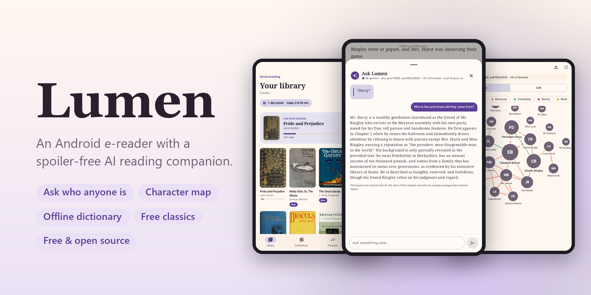
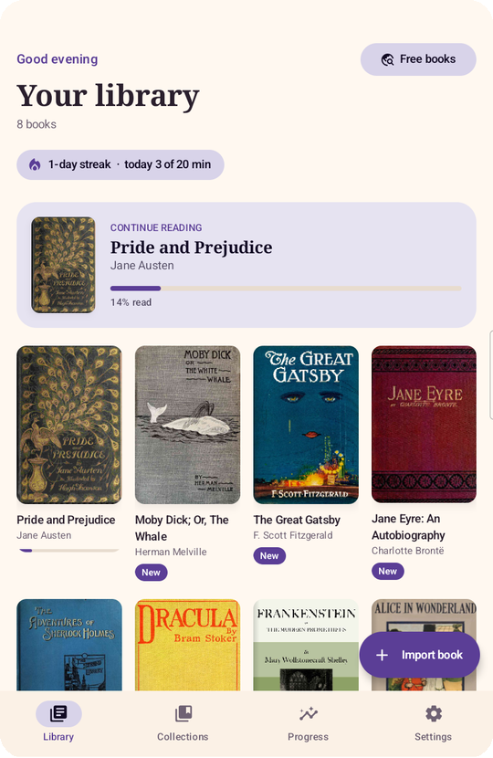
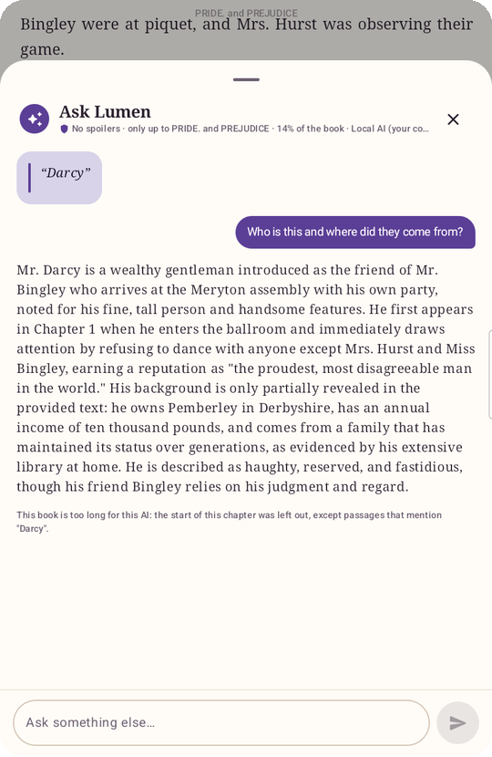
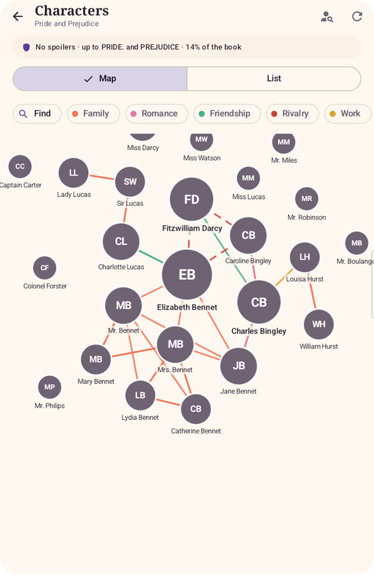
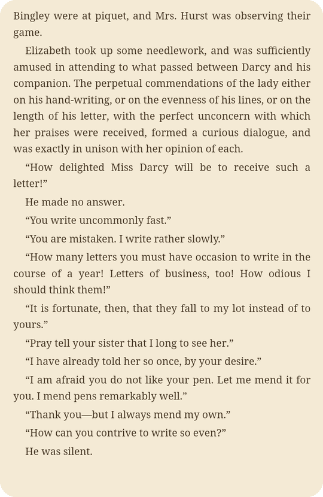
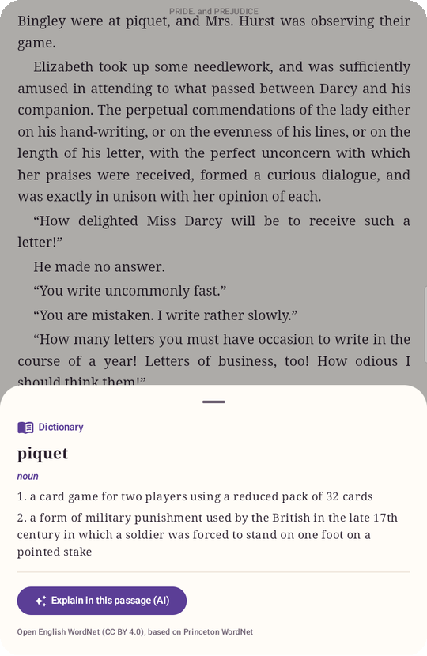
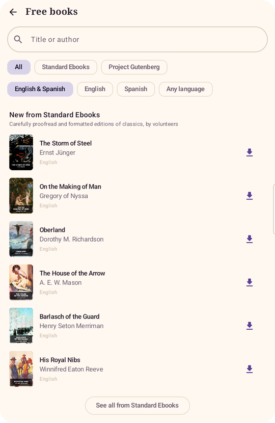
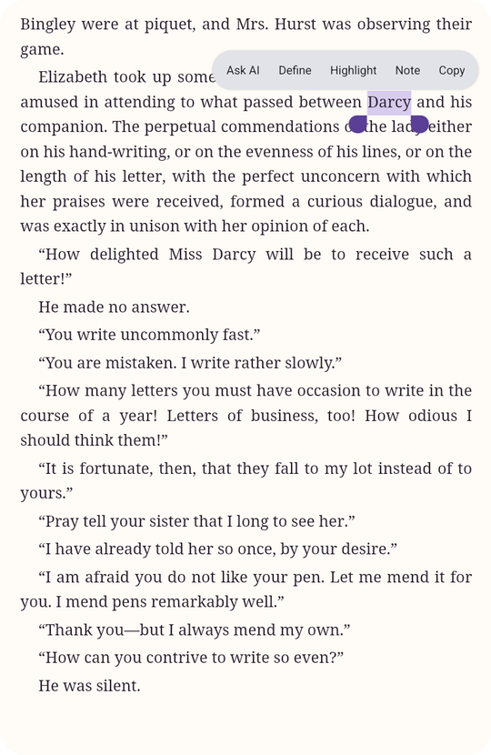
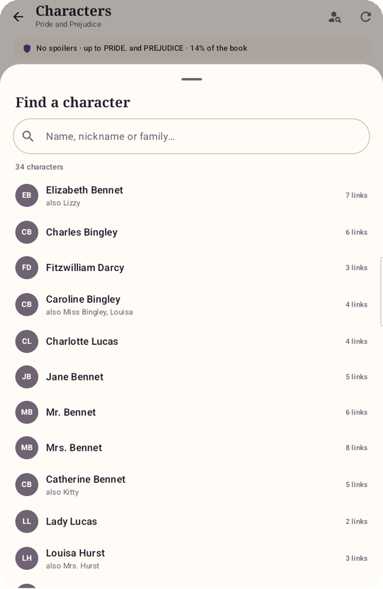
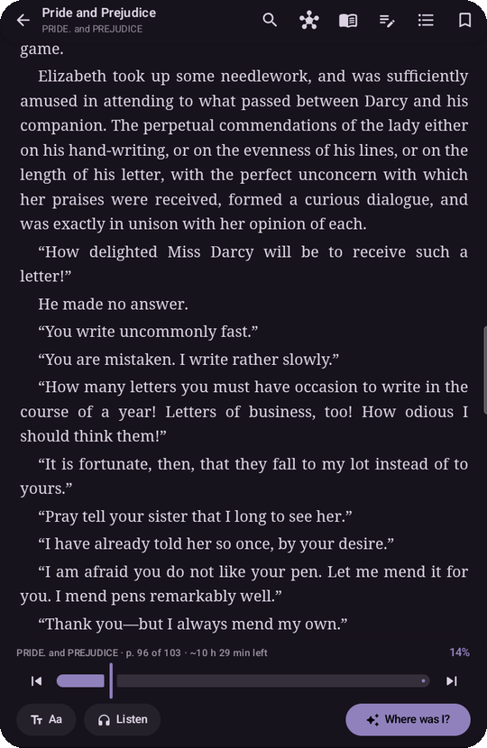

# Lumen — an Android e-reader with a spoiler-free AI reading companion

<p align="center"></p>

<p align="center">
  <a href="https://github.com/ronaldochavez/lumen-reader/releases/latest"></a>
  
  <a href="LICENSE"></a>
</p>

On page 180 and a character shows up that you can't place? Select the name and ask Lumen who it is: the AI only
reads the book **from the beginning up to your page**, so it never gives anything away.

A reader with a warm, cozy look: a library with covers, collections, highlights in 4 colors with notes, bookmarks,
a table of contents, Paper / Sepia / Night / Black themes and an accent color of your choice.

## Screenshots

<table>
<tr>
<td align="center" width="33%"><br><b>Your library</b><br><sub>Covers, collections and “continue reading”</sub></td>
<td align="center" width="33%"><br><b>Ask Lumen</b><br><sub>Who is this? It only reads up to your page</sub></td>
<td align="center" width="33%"><br><b>Character map</b><br><sub>Who’s who and how they’re connected</sub></td>
</tr>
<tr>
<td align="center" width="33%"><br><b>Made for reading</b><br><sub>Paper, Sepia, Night and Black themes</sub></td>
<td align="center" width="33%"><br><b>Offline dictionary</b><br><sub>English and Spanish, no AI needed</sub></td>
<td align="center" width="33%"><br><b>Free books</b><br><sub>Project Gutenberg and Standard Ebooks</sub></td>
</tr>
<tr>
<td align="center" width="33%"><br><b>Select any text</b><br><sub>Ask, define, highlight or add a note</sub></td>
<td align="center" width="33%"><br><b>Find anyone</b><br><sub>Search the cast in crowded books</sub></td>
<td align="center" width="33%"><br><b>Night reading</b><br><sub>Accent color of your choice</sub></td>
</tr>
</table>

<sub>On a Galaxy Tab A9, with public-domain books downloaded from Project Gutenberg inside the app. The answers and the map come from Qwen running on a home computer with Ollama.</sub>

## Download and install

1. On your Android phone or tablet (8.0 or newer), open the [**Releases**](../../releases/latest) page and download
   `Lumen-*.apk`.
2. Open it. Android will ask to allow "install unknown apps" for your browser or file manager: allow it just for
   this install.
3. Import your books with **Import book** (EPUB, PDF, MOBI, comics…), or tap **Free books** to download classics
   from Project Gutenberg and Standard Ebooks.
4. For the AI, the app walks you through creating a **free** Google Gemini key (no card needed) the first time you
   ask something. You can also run a free model on your own computer ([Ollama](#free-and-private-a-model-on-your-own-computer-ollama))
   or use your own Anthropic (Claude) key.

Your books, highlights and keys stay on your device; there are no Lumen accounts or servers. Only your question
(and the book up to your page) is sent to the AI provider you choose.

## Formats

| Format | How it's read | AI / character map |
|---|---|---|
| EPUB | Reflowable text (paginated WebView) | Yes |
| MOBI, AZW3, AZW, PRC (DRM-free) | Converted to HTML chapters on import | Yes |
| FB2 / FB2.ZIP, DOCX, RTF, TXT, MD, HTML | Converted to HTML chapters on import | Yes |
| PDF | Pages with their original layout (PdfRenderer), pinch to zoom | Yes, using the text extracted per page (not for scanned PDFs) |
| CBZ, CBR (RAR4) | Image pages | No (there's no text) |

Books with DRM (Kindle, Adobe, Apple, LCP) aren't supported: the app detects them and explains why. Neither are
DjVu, CHM, LIT or KFX; for those, converting with Calibre is suggested. MOBI with HUFF/CDIC compression (rare)
isn't supported yet.

## More features

- **Free books:** Library → *Free books* searches [Project Gutenberg](https://www.gutenberg.org) (75,000+
  books, through [Gutendex](https://gutendex.com)) and [Standard Ebooks](https://standardebooks.org) (carefully
  formatted classics) and adds a book to your library in one tap. Only public-domain books; filter by English,
  Spanish or any language.
- **Dictionary:** in the selection menu, "Define" looks the word up in a built-in English and Spanish dictionary
  (offline, instant, no AI): *darning* → *darn*, *dijo* → *decir*. "Explain in this passage (AI)" then explains it
  as used there (and translates it if the book is in another language than yours), sending only the surrounding
  paragraph, never text past the visible page. Sources and licenses: [THIRD_PARTY_NOTICES.md](THIRD_PARTY_NOTICES.md).
- **Book encyclopedia:** places, objects, terms, factions and events, each with its own entry, up to your page.
- **Search in the book:** case- and accent-insensitive; by default only up to where you are (no spoilers).
- **Read aloud:** the system voice (offline and free) highlights the current sentence and turns pages by itself.
  It pauses when you leave the app (there's no background audio service yet).
- **Progress:** minutes per day, streak, daily goal and "~X left to finish" based on your real pace. Time only
  counts while the reader is on screen and you've been active in the last 3 minutes.
- **Volume buttons:** volume down = next page, volume up = previous (can be turned off in Settings → Reading;
  while reading aloud, the buttons control the volume).
- **Back to where you were:** after a jump (search, contents, highlight, slider, link) a button takes you back;
  the saved position doesn't change until you read 3 pages at the new spot or tap ✕.
- **Backup:** Settings → Your data creates a .zip with your books, highlights, notes, bookmarks, collections,
  progress and stats, and restores it (the previous library is kept for 7 days in `pre-restore/`). It also exports
  your highlights to Markdown. Before any database upgrade, the database is copied to `db-snapshots/`.

And the spoiler-free AI features:

- **Ask Lumen.** Long-press any text → *Ask AI* → "Who is this and where did they come from?". The AI receives
  **only the book from the beginning to the end of your current page** and is instructed not to use anything it
  may know about the book from elsewhere. It works for places, objects, terms and events too. The
  **Where was I?** button opens the same chat, empty, so you can ask for a recap or anything else.
- **Character map.** An interactive map (zoom, pan, tap a character) of who's who and how they're connected,
  built up to your page. It's saved; when you read further, it offers to update it. If you went back and the
  saved map goes further than you, it warns you before showing it. In crowded books, *Find* searches the cast by
  name, nickname or group and flies the map to that person.

The AI answers in the language of your question; the map and the encyclopedia are written in your device's
language.

## Build and install

Requirements: JDK 17 and Android SDK 36 (or just a recent Android Studio).

```bash
./gradlew :app:assembleDebug
```

The APK ends up in `app/build/outputs/apk/debug/app-debug.apk`. With a phone connected (USB debugging):

```bash
./gradlew :app:installDebug
```

For a signed release APK, create `keystore.properties` in the project root (it's never committed) with
`storeFile`, `storePassword`, `keyAlias` and `keyPassword`, then run `./gradlew :app:assembleRelease`.

## AI: free first, personal key later

1. **Free (Gemini).** The first time you ask something, the AI sheet offers to turn it on: Google AI Studio opens,
   you create a free key (no card) and paste it right there. It uses `gemini-3.8-flash` (1M-token context), and
   retries and falls back to `gemini-3.7-flash` when Google is overloaded. On the free plan, Google may use the
   text to improve its products; the app says so.
2. **Personal (Claude).** If the free quota runs out (error 429), the app explains it and suggests adding an
   Anthropic key in Settings. With an Anthropic key, Claude takes priority (Opus 5.5 by default; Sonnet 5.5 or
   Haiku 4.5 optional).

Both keys are stored encrypted with the Android Keystore. The prompts and anti-spoiler rules are the same for every
provider (`ai/AiCommon.kt`); `AiService` picks the provider on each request.

### Free and private: a model on your own computer (Ollama)

Lumen can use a model like Qwen running on your computer with [Ollama](https://ollama.com): no keys, no limits,
and your books never leave your home network. When it's set up, it takes priority; when your computer is off or
the tablet is on another network, Lumen quietly falls back to Claude or Gemini.

1. Install Ollama on your computer and download a model. `qwen3.5:9b` (6.6 GB) fits entirely on a 12 GB GPU and
   answers well in English and Spanish:

   ```bash
   ollama pull qwen3.5:9b
   ```

2. Let Ollama accept connections from your network and give it a 32K-token context. On Windows (then quit Ollama
   from the tray and open it again):

   ```bash
   setx OLLAMA_HOST 0.0.0.0:11434
   setx OLLAMA_CONTEXT_LENGTH 32768
   ```

3. Allow port 11434 through the firewall on your private (home) network, and make sure Windows treats that network
   as Private.
4. On the phone or tablet, open `http://<your-computer's-IP>:11434` in the browser: it should say "Ollama is
   running". Then, in Lumen, go to Settings → "Free on your computer (Ollama)", enter that address and tap
   *Save and check*.

A local model's context window is much smaller than Gemini's or Claude's, so long books are trimmed to the most
recent chapters plus earlier passages that mention what you asked about (starting with its first appearance).
Answers are good for "who is this?" and recaps, but a little less precise than the big cloud models.

## How "no spoilers" works

1. On import, each chapter is converted to plain text (`files/books/<id>/.folio/text/<n>.txt`).
2. The reader paginates each chapter with CSS columns inside a WebView. `reader.js` measures positions as
   *character offsets* in the chapter text, so it knows exactly which character is the last one visible.
3. When you ask, it sends the previous chapters in full + the current chapter **cut at the last character of your
   page** (or the end of your selection if it runs past the page), with a `[THE READER IS HERE…]` marker.
4. The system prompt forbids using outside knowledge of the book and speculating about what comes next.
5. Introductions, prefaces, "From the pages of…" teasers and chronologies in classic editions often tell the whole
   plot, and they always come before your page. When the contents list shows one before "Part One", "Chapter 1" or
   similar, the AI's text starts at the story (`FrontMatter.kt`); while you're still reading the introduction
   itself, it gets what you've read of it.

Tokens: by default (Settings → *Use fewer tokens*) a question about something you selected sends only the passages
that mention it, by any name the character map knows, plus the last pages: about 15K tokens instead of everything
read so far (often 100K or more). The open chat sends the last ~40 pages. *Read the whole book* under an answer
asks again with everything. Asking the same thing at the same place shows the saved answer (no tokens), and with
Claude the book text of follow-up questions comes from the prompt cache, at a fraction of the price.

## Project structure

```
app/src/main/
  assets/reader/          reader.js (pagination, offsets, highlights, selection) + reader.css
  java/com/folio/reader/
    ai/                   Claude (Anthropic Java SDK) and Gemini (REST) services, spoiler-free context, prompts
    data/                 Room (books, chapters, contents, highlights, bookmarks, collections, maps, stats),
                          EPUB importer/parser, settings (DataStore + Keystore), backups
    data/convert/         Format detection and converters (MOBI, FB2, DOCX, RTF, TXT, HTML),
                          PDF (pdfbox-android) and comic (CBZ/CBR) import
    data/dictionary/      Offline dictionary lookups and English/Spanish inflection rules
    data/catalog/         Project Gutenberg (Gutendex) and Standard Ebooks search and downloads
    ui/reader/fixed       Page reader for PDFs and comics
    ui/library            Library ("Continue reading", collection filters, import)
    ui/catalog            Free books: search and one-tap download
    ui/collections        Collections
    ui/reader             Reader: WebView, custom selection menu, contents/notes/typography/AI sheets
    ui/graph              Character map (force layout + Canvas)
    ui/encyclopedia       Book encyclopedia
    ui/stats              Progress, streaks and daily goal
    ui/settings           Appearance, reading, AI keys and model, backups
tools/reader-harness.html Tests the reading engine in a desktop browser (tools/serve.ps1)
tools/dictionary/         Builds the dictionaries in assets/dictionary/ from Open English WordNet and Wiktionary
```

JVM tests: `./gradlew :app:testDebugUnitTest` (request shapes for Claude and Gemini, the spoiler cut, converters,
stats, search, theme contrast, highlight export).

## To do / ideas

- Highlights in PDFs (bookmarks only today) and a PDF "reflow" mode.
- MOBI with HUFF/CDIC compression; CBR in RAR5; CB7.
- Automatic sync between devices (today: manual .zip backup).
- Background audio for read-aloud.
- To publish on the Play Store for users without an API key: a small backend that holds the key.

## License

[MIT](LICENSE). The internal code (package `com.folio.reader`) keeps the project's original name.
